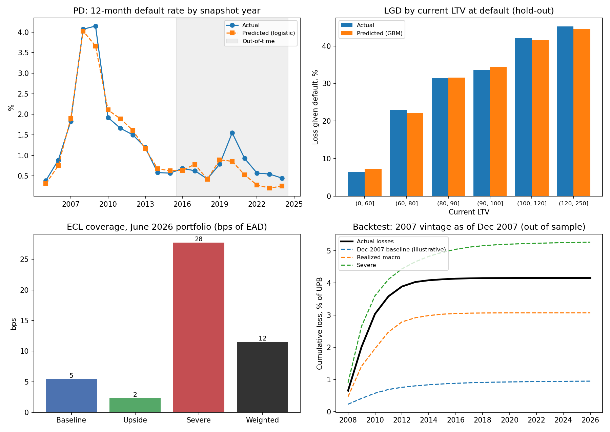

# IFRS 9 / CECL Expected Credit Loss Model: US Residential Mortgages

An end-to-end expected credit loss (ECL) model on Freddie Mac loan-level data. It covers PD with competing prepayment risk, LGD, EAD, macro scenarios, IFRS 9 staging and an out-of-sample backtest through the 2008 crisis.

**Data:** [Freddie Mac Single-Family Loan-Level Dataset](https://www.freddiemac.com/research/datasets/sf-loanlevel-dataset), 50,000-loan samples for the 2005, 2006, 2007, 2010, 2014 and 2018 vintages. That is 300,000 loans with monthly performance through June 2026: 19 million loan-months, 25,190 defaults and actual loss amounts. Macro data come from FRED: unemployment, the Case-Shiller national HPI, the 30-year mortgage rate and FHFA state HPIs. The data are not redistributed here (Freddie Mac terms of use); `src/prepare.py` rebuilds everything from the downloaded files.

## Results

| Component | Method | Validation |
|---|---|---|
| **PD** (12-month, with prepayment as a competing risk) | Multinomial logistic regression with splines; 1.44M annual loan snapshots | AUC **0.896** on held-out loans, **0.870** out of time (2016–2024, incl. COVID); yearly default rate tracks 2005–2024 (chart) |
| PD challenger | Gradient boosting | AUC 0.777 out of time, predicted default rate 3x actual, so it was **rejected** in favour of the logistic model |
| **LGD** | Gradient boosting on 14,237 resolved defaults (liquidations at actual loss, cures at 0) | RMSE 0.275; mean predicted 25.5% vs actual 25.6%; LGD rises from 7% (LTV < 60) to 45% (LTV > 120) |
| **EAD** | Scheduled amortization of the current balance | n/a |

**June 2026 portfolio** (24,837 active loans, $2.83bn):

| Scenario (weight) | Unemployment | House prices | ECL coverage |
|---|---|---|---|
| Baseline (50%) | 4.4–4.5% | +2–3% a year | 5 bps |
| Upside (20%) | 3.8–4.0% | +4–5% a year | 2 bps |
| Severe (30%) | peaks at 10% | −20%, then −12% | 28 bps |
| **Probability-weighted** | n/a | n/a | **12 bps ($3.3m)** |

Staging: Stage 1 is 94.8% of EAD (coverage 0.03%), Stage 2 is 4.1% (0.82%) and Stage 3 is 1.2% (4.3%). Stage 2 is triggered by 30+ days past due, a forbearance plan, or a 12-month PD more than 3x the PD at origination and at least 0.5 points higher.

**Backtest: 2007 vintage as of December 2007** (42,394 loans, $7.6bn, never used in fitting):

| As of Dec 2007 | Predicted lifetime loss | Actual |
|---|---|---|
| Benign baseline (the view before the crash) | 0.95% | n/a |
| Realized macro path (actual unemployment, state house prices, rates) | 3.07% | **4.16%** |
| Severe scenario | 5.27% | n/a |

With the macro path that actually happened, the model explains about **74% of realized losses**. One year ahead from actual December states, it predicted 4.1–4.7% default rates in 2008–09 against 5.4–5.5% actual, then slightly overpredicted 2010–11. The scenario weights matter more than the model: under a benign baseline alone the reserve would have been about 4x too low.



## Method

1. **Default definition:** 90+ days past due, REO, short sale or third-party sale. Delinquency during a COVID-19 forbearance plan is *not* default; it triggers Stage 2.
2. **PD and prepayment:** for every performing loan each December, the outcome over the next 12 months is default, prepay or stay. Drivers:
   - FICO, DTI and original LTV.
   - Current LTV marked to the state house price index.
   - Delinquency status and forbearance.
   - Loan age and refinance incentive (note rate minus market rate).
   - Occupancy, purpose and property type.
   - Unemployment and its change, and state HPI growth.
3. **LGD:** severity at default as a function of current LTV, forward state HPI growth, mortgage insurance, judicial foreclosure state and loan size.
4. **ECL engine:** for each loan and year, PD and prepayment probabilities come from the scenario path. Survival is chained across years, and losses are discounted at the note rate. Stage 1 uses the 12-month ECL, Stage 2 lifetime ECL, and Stage 3 LGD × EAD.

## Limitations

- **Multi-year projection assumes surviving loans are current.** In a crisis many survivors are delinquent, so lifetime PD is understated. A delinquency roll-rate (Markov) model would fix this.
- **Vintage effects:** the 2007 vintage, originated at the house price peak, was riskier than the 2005–06 vintages the model learned from.
- The COVID-19 spike (2020) is underpredicted; unemployment that brief and that policy-cushioned has no precedent in the training data.
- Scenario paths and weights are illustrative, not an official forecast. Uncertainty in the scenario weights dominates model error.
- The models are fitted on a 50% loan sample for speed; results are stable to this choice.

## Run

```bash
python src/prepare.py   # needs data/raw/sample_*.txt and data/macro/*.csv
python src/model.py     # pandas, numpy, scikit-learn, matplotlib, pyarrow
```

Outputs: `outputs/metrics.json`, `outputs/ecl_model.png`, `outputs/pd_calibration_by_year.csv`, `outputs/backtest_2007_one_year_pd.csv`.
